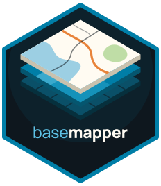

# basemapper 

<!-- badges: start -->
<!-- badges: end -->

> **Also available for Python** — the same Rust core, and the same functions
> and argument names (`verb(m, ...)` here is `m.verb(...)` in Python).
> [Python documentation →](https://ar-puuk.github.io/basemapper/python/)

**basemapper** renders MapLibre GL basemaps (vector and raster styles)
headlessly with a Rust core: to PNG, arrays, {terra} rasters or true vector
SVG, at any fractional zoom and pixel ratio, and as {ggplot2} and {tmap} v4
layers that render at the output device's resolution.

## Installation

### Prerequisites

The package compiles a Rust extension during installation. Install the
dependencies for your platform before proceeding.

#### Windows

```powershell
# 1. RTools45 (compiler toolchain required by R on Windows)
winget install RProject.Rtools

# 2. Rust toolchain manager
winget install Rustlang.Rustup
```

After installation, **open a new terminal** so both tools are on your `PATH`,
then add the Windows GNU target that RTools45 uses:

```powershell
rustup target add x86_64-pc-windows-gnu
```

#### macOS / Linux

```bash
# Rust toolchain manager (installs rustc and cargo)
curl https://sh.rustup.rs -sSf | sh
```

macOS users also need the Xcode Command Line Tools (`xcode-select --install`)
if not already present.

### Install the package

```r
# install.packages("remotes")
remotes::install_github("ar-puuk/basemapper", subdir = "r-basemapper")
```

## Quick example

```r
library(basemapper)

# Built-in basemaps by leaflet name (list_providers(), providers$...);
# the name works as a style
style <- "OpenFreeMap.Liberty"
style <- basemap_provider("Esri.WorldGrayCanvas", type = "raster")   # pick the form
style <- basemap_provider("OpenFreeMap.Liberty", tiles = "data/omt.pmtiles")   # your own tiles

# Stack parts of basemaps: imagery under a vector basemap's labels
hybrid <- c("Esri.WorldImagery", basemap_provider("OpenFreeMap.Liberty", labels = "only"))
# labels = FALSE / "only", features = c("water", "roads") / "-buildings"

# A view: centre + zoom, or bounds to fit
m <- basemap(style, 800, 600, center = c(-122.45, 37.75), zoom = 12, pixel_ratio = 2)
render_png(m, path = "sf.png")     # 1600 x 1200
render_svg(m, path = "sf.svg")     # true vector
get_bounds(set_view(m, zoom = 13), lonlat = TRUE)

# One-shot render of bounds to a georeferenced [height, width, 4] array
a <- render_basemap_raw(c(-122.5, 37.7, -122.4, 37.8), 400, 300, style)

# Your own tile data works as a style: tile URLs, TileJSON, PMTiles
# archives (URL or local file), ArcGIS services
m <- basemap("data/area.pmtiles", 800, 600, bounds = c(-122.5, 37.7, -122.4, 37.8))
style <- tile_style("https://example.com/{z}/{x}/{y}.png", maxzoom = 16)   # with overrides
style <- wms_style("https://gis.example.com/wms", layers = "imagery")
```

## Get started

See the [Getting Started vignette](articles/getting-started.html) for a
walkthrough of rendering basemaps with {ggplot2}, {tmap}, and raw RGBA output.

## Related

- [Python docs](https://ar-puuk.github.io/basemapper/python/) — the Python
  package exposes the same Rust core via PyO3.
