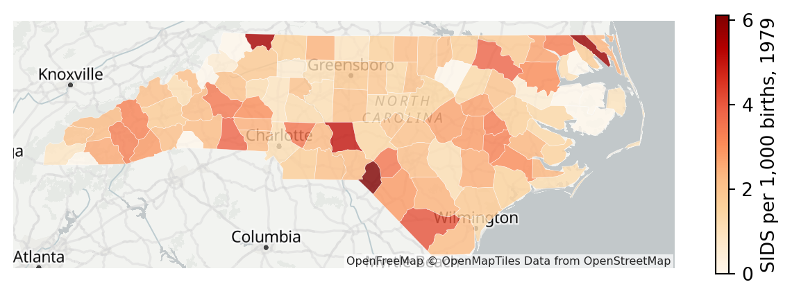
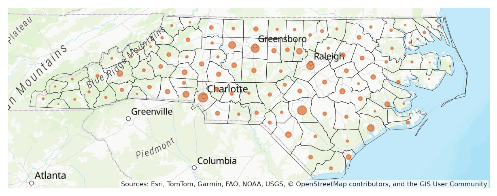
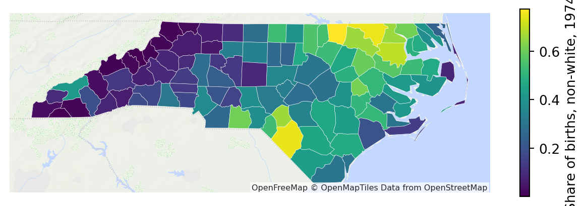
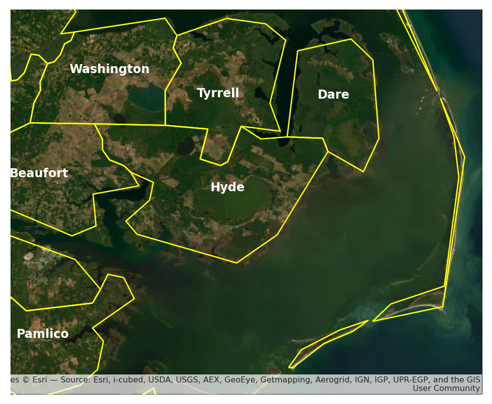
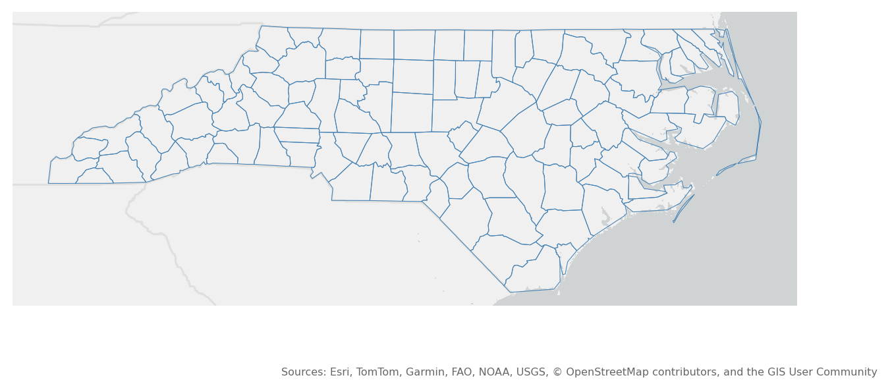
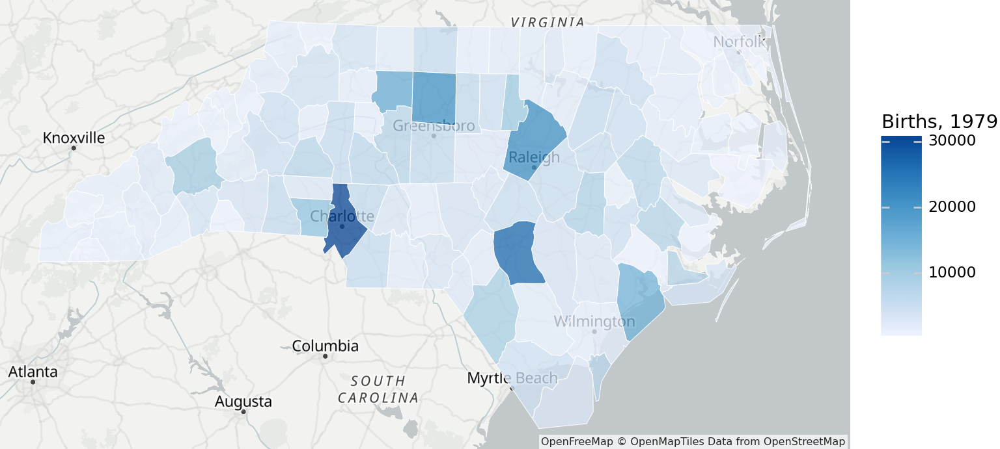
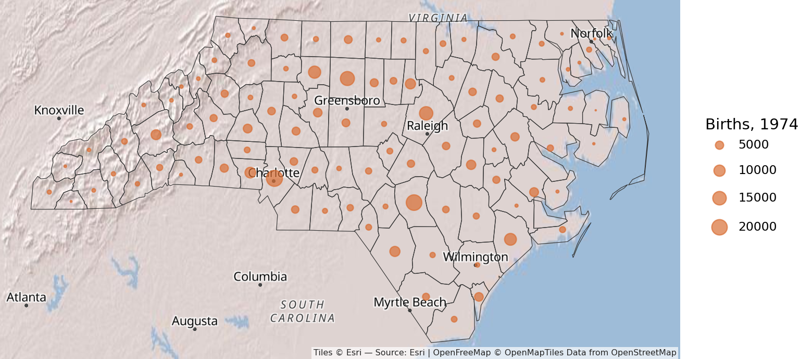

# Plots with matplotlib and plotnine

[add_basemap()](reference/add_basemap.html#basemapper.add_basemap) (matplotlib) and [geom_basemap()](reference/geom_basemap.html#basemapper.geom_basemap) (plotnine) add a basemap under your data. They render when the figure is drawn, for the axes' extent and at the output resolution: on screen, in this page, or in `savefig(dpi=300)` and `save(dpi=300)`, labels stay sharp and the right size. Both take the arguments of [basemap()](reference/basemap.html#basemapper.basemap)'s renderers (`labels`, `features`, `layers`, `alpha`, …) and credit the provider in the corner.


``` python
import warnings
warnings.filterwarnings("ignore", message=".*centroid.*")

import basemapper as bm
import geodatasets
import geopandas as gpd
import matplotlib.pyplot as plt

nc = gpd.read_file(geodatasets.get_path("geoda.sids"))
```


# matplotlib

[add_basemap()](reference/add_basemap.html#basemapper.add_basemap) draws under what the axes already show. Give it the data's CRS with `crs=`:


``` python
fig, ax = plt.subplots(figsize=(8, 3.6))
nc.assign(rate=nc.SID79 / nc.BIR79 * 1000).plot(
    ax=ax, column="rate", cmap="OrRd", alpha=0.8, edgecolor="white", linewidth=0.2,
    legend=True, legend_kwds={"label": "SIDS per 1,000 births, 1979", "shrink": 0.7},
)
bm.add_basemap(ax, "OpenFreeMap.Positron", crs=nc.crs)
ax.set_axis_off()
```


<figure class="figure">
<p></p>
</figure>


## Projected data

The basemap is rendered in Web Mercator and warped to the axes' CRS, so data in any CRS works. Here North Carolina's state plane (EPSG:32119), with the counties' centroids sized by births:


``` python
nc_sp = nc.to_crs(32119)
fig, ax = plt.subplots(figsize=(8, 3.6))
nc_sp.boundary.plot(ax=ax, color="0.15", linewidth=0.3)
nc_sp.centroid.plot(ax=ax, markersize=nc_sp.BIR74 / 300, color="#D96E34", alpha=0.7)
bm.add_basemap(ax, "Esri.WorldTopoMap", crs=nc_sp.crs)
ax.set_axis_off()
```


<figure class="figure">
<p></p>
</figure>


## A quieter basemap

For a data map, a basemap often reads better without its labels, faded, or with only some of its features (see [Stacking, labels and features](layers.md)):


``` python
fig, ax = plt.subplots(figsize=(8, 3.6))
nc.assign(share=nc.NWBIR74 / nc.BIR74).plot(
    ax=ax, column="share", cmap="viridis", edgecolor="white", linewidth=0.2, legend=True,
    legend_kwds={"label": "Share of births, non-white, 1974", "shrink": 0.7},
)
bm.add_basemap(ax, "OpenFreeMap.Liberty", labels=False, features=["-roads", "-rail"], alpha=0.6, crs=nc.crs)
ax.set_axis_off()
```


<figure class="figure">
<p></p>
</figure>


## Zooming in

The basemap follows the axes, so setting their limits zooms it in, with detail to match:


``` python
fig, ax = plt.subplots(figsize=(8, 5.2))
nc.boundary.plot(ax=ax, color="yellow", linewidth=1)
for _, row in nc.iterrows():
    p = row.geometry.representative_point()
    if -76.9 < p.x < -75.4 and 35.0 < p.y < 36.0:
        ax.annotate(row.NAME, (p.x, p.y), color="white", fontsize=9, fontweight="bold", ha="center")
ax.set_xlim(-76.9, -75.4)
ax.set_ylim(35.0, 36.0)
bm.add_basemap(ax, "Esri.WorldImagery", crs=nc.crs)
ax.set_axis_off()
```


<figure class="figure">
<p></p>
</figure>


## Credits

The credit line is on by default. `attribution=False` turns it off; [get_attribution()](reference/get_attribution.html#basemapper.get_attribution) returns the text, for a caption:


``` python
fig, ax = plt.subplots(figsize=(8, 3.6))
nc.boundary.plot(ax=ax, color="steelblue", linewidth=0.4)
bm.add_basemap(ax, "Esri.WorldGrayCanvas", attribution=False, crs=nc.crs)
ax.set_axis_off()
fig.text(0.98, 0.02, bm.get_attribution("Esri.WorldGrayCanvas"), ha="right", fontsize=6, color="0.4")
```


<figure class="figure">
<p></p>
</figure>


# plotnine

[geom_basemap()](reference/geom_basemap.html#basemapper.geom_basemap) is a plotnine layer with the arguments of R's [geom_basemap()](reference/geom_basemap.html#basemapper.geom_basemap):


``` python
from plotnine import aes, geom_map, ggplot, labs, scale_fill_distiller, theme, theme_void

(
    ggplot(nc)
    + bm.geom_basemap("OpenFreeMap.Positron")
    + geom_map(aes(fill="BIR79"), alpha=0.75, color="white", size=0.2)
    + scale_fill_distiller(type="seq", palette="Blues", direction=1, name="Births, 1979")
    + theme_void()
    + theme(figure_size=(8, 3.6))
)
```


<figure class="figure">
<p></p>
</figure>


Raster and vector basemaps, stacks, labels and features work the same way; here shaded relief under a vector basemap's labels:


``` python
from plotnine import geom_point, scale_size_area

relief = ["Esri.WorldShadedRelief", bm.basemap_provider("OpenFreeMap.Liberty", labels="only")]
centroids = nc.assign(x=nc.centroid.x, y=nc.centroid.y)

(
    ggplot(centroids)
    + bm.geom_basemap(relief)
    + geom_map(fill=None, color="#333333", size=0.25)
    + geom_point(aes("x", "y", size="BIR74"), color="#D96E34", alpha=0.7)
    + scale_size_area(max_size=6, name="Births, 1974")
    + theme_void()
    + theme(figure_size=(8, 3.6))
)
```


<figure class="figure">
<p></p>
</figure>
