# Basemap gallery

Every basemap in the catalogue that needs no API key, rendered for the
same view of the San Francisco Bay Area. The names work as `style`
anywhere: in
[`basemap()`](https://ar-puuk.github.io/basemapper/r/reference/basemap.md),
[`geom_basemap()`](https://ar-puuk.github.io/basemapper/r/reference/geom_basemap.md),
[`tm_basemap()`](https://ar-puuk.github.io/basemapper/r/reference/tm_basemap.md)
and in Python and Rust.

\
[`library`](https://rdrr.io/r/base/library.html)`(`[`basemapper`](https://ar-puuk.github.io/basemapper/r/)`)`\
\
`p`` ``<-`` `[`list_providers`](https://ar-puuk.github.io/basemapper/r/reference/list_providers.md)`(``)`\
`keyless`` ``<-`` ``p``$``name``[`[`is.na`](https://rdrr.io/r/base/NA.html)`(``p``$``api_key_env``)``]`\
[`length`](https://rdrr.io/r/base/length.html)`(``keyless``)`\
`#> [1] 23`\
\
`dir`` ``<-`` `[`file.path`](https://rdrr.io/r/base/file.path.html)`(`[`tempdir`](https://rdrr.io/r/base/tempfile.html)`(``)``, ``"gallery"``)`\
[`dir.create`](https://rdrr.io/r/base/files2.html)`(``dir``, showWarnings ``=`` ``FALSE``)`\
`for`` ``(``name`` ``in`` ``keyless``)`` ``{`\
`  ``m`` ``<-`` `[`basemap`](https://ar-puuk.github.io/basemapper/r/reference/basemap.md)`(``name``, ``340``, ``220``, center ``=`` `[`c`](https://rdrr.io/r/base/c.html)`(``-``122.25``, ``37.75``)``, zoom ``=`` ``9``)`\
`  `[`render_png`](https://ar-puuk.github.io/basemapper/r/reference/render_png.md)`(``m``, path ``=`` `[`file.path`](https://rdrr.io/r/base/file.path.html)`(``dir``, `[`paste0`](https://rdrr.io/r/base/paste.html)`(``name``, ``".png"``)``)``)`\
`}`

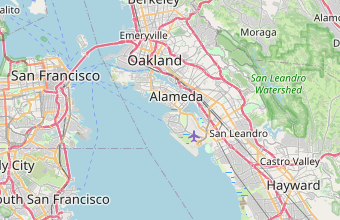

`OpenStreetMap.Mapnik` raster

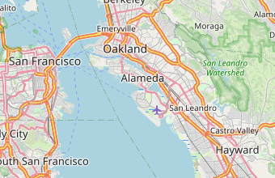

`OpenStreetMap.DE` raster

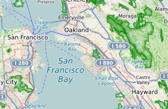

`OpenStreetMap.France` raster

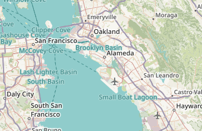

`OpenStreetMap.HOT` raster

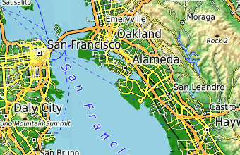

`OpenTopoMap` raster

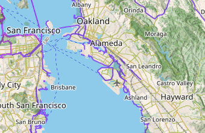

`CyclOSM` raster

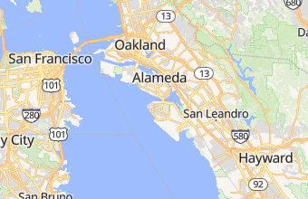

`OpenFreeMap.Liberty` vector

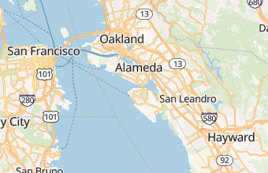

`OpenFreeMap.Bright` vector

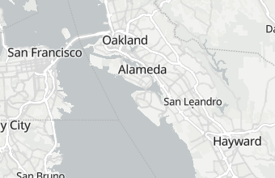

`OpenFreeMap.Positron` vector

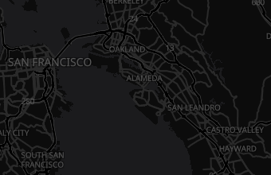

`OpenFreeMap.Dark` vector

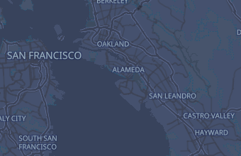

`OpenFreeMap.Fiord` vector

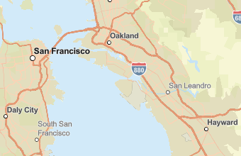

`Esri.WorldStreetMap` vector

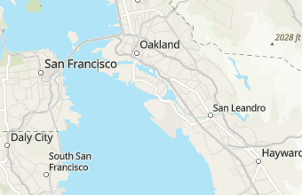

`Esri.WorldTopoMap` vector

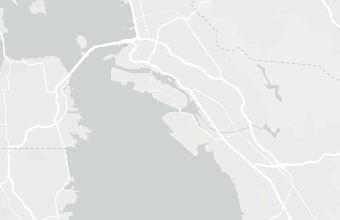

`Esri.WorldGrayCanvas` vector

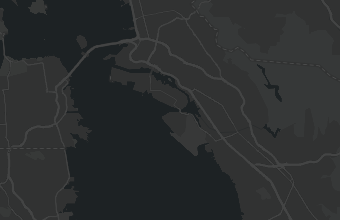

`Esri.WorldDarkGrayCanvas` vector

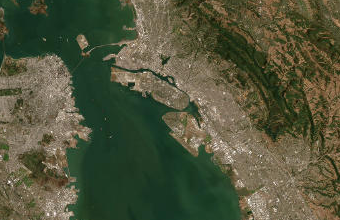

`Esri.WorldImagery` raster

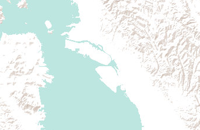

`Esri.WorldTerrain` raster

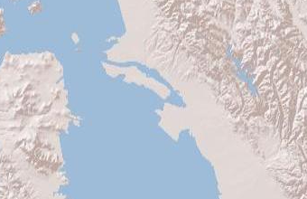

`Esri.WorldShadedRelief` raster

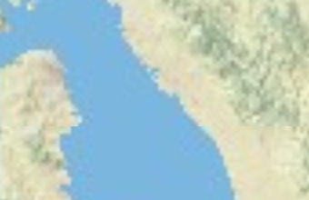

`Esri.WorldPhysical` raster

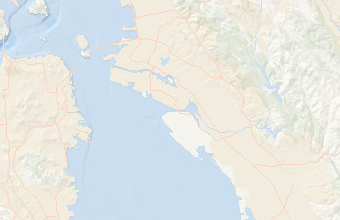

`Esri.OceanBasemap` raster

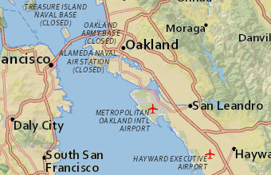

`Esri.NatGeoWorldMap` raster

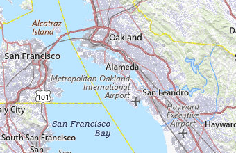

`USGS.USTopo` raster

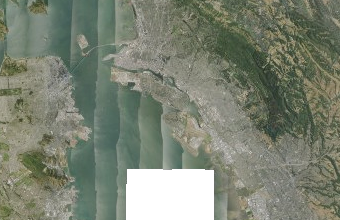

`USGS.USImagery` raster

The vector basemaps (OpenFreeMap, and Esri’s vector styles) are drawn
from vector tiles by basemapper’s port of MapLibre GL JS; the raster
ones are tile images. Esri’s names have both forms;
`basemap_provider(name, type = "raster")` picks the other one.

## With an API key

CARTO, Stadia Maps and MapTiler need a free API key, read from the
environment variable in `api_key_env` (or given as `api_key =` to
[`basemap_provider()`](https://ar-puuk.github.io/basemapper/r/reference/basemap_provider.md)):

\
`p``[``!`[`is.na`](https://rdrr.io/r/base/NA.html)`(``p``$``api_key_env``)``, `[`c`](https://rdrr.io/r/base/c.html)`(``"name"``, ``"vector"``, ``"raster"``, ``"api_key_env"``)``]`\
`#>                        name vector raster      api_key_env`\
`#> 12         CartoDB.Positron   TRUE   TRUE    CARTO_API_KEY`\
`#> 13       CartoDB.DarkMatter   TRUE   TRUE    CARTO_API_KEY`\
`#> 14          CartoDB.Voyager   TRUE   TRUE    CARTO_API_KEY`\
`#> 27     Stadia.AlidadeSmooth   TRUE   TRUE   STADIA_API_KEY`\
`#> 28 Stadia.AlidadeSmoothDark   TRUE   TRUE   STADIA_API_KEY`\
`#> 29  Stadia.AlidadeSatellite   TRUE   TRUE   STADIA_API_KEY`\
`#> 30         Stadia.OSMBright   TRUE   TRUE   STADIA_API_KEY`\
`#> 31          Stadia.Outdoors   TRUE   TRUE   STADIA_API_KEY`\
`#> 32       Stadia.StamenToner   TRUE   TRUE   STADIA_API_KEY`\
`#> 33   Stadia.StamenTonerLite   TRUE   TRUE   STADIA_API_KEY`\
`#> 34     Stadia.StamenTerrain   TRUE   TRUE   STADIA_API_KEY`\
`#> 35  Stadia.StamenWatercolor   TRUE   TRUE   STADIA_API_KEY`\
`#> 36         MapTiler.Streets   TRUE   TRUE MAPTILER_API_KEY`\
`#> 37           MapTiler.Basic   TRUE   TRUE MAPTILER_API_KEY`\
`#> 38          MapTiler.Bright   TRUE   TRUE MAPTILER_API_KEY`\
`#> 39         MapTiler.Outdoor   TRUE   TRUE MAPTILER_API_KEY`\
`#> 40            MapTiler.Topo   TRUE   TRUE MAPTILER_API_KEY`\
`#> 41         MapTiler.Dataviz   TRUE   TRUE MAPTILER_API_KEY`\
`#> 42       MapTiler.Satellite   TRUE   TRUE MAPTILER_API_KEY`
