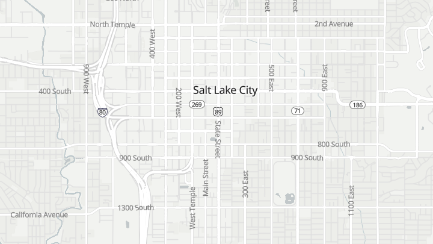
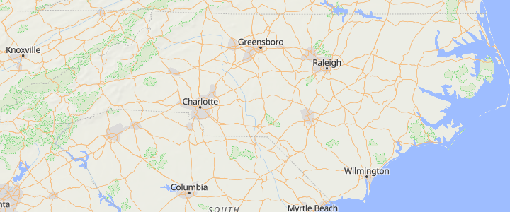
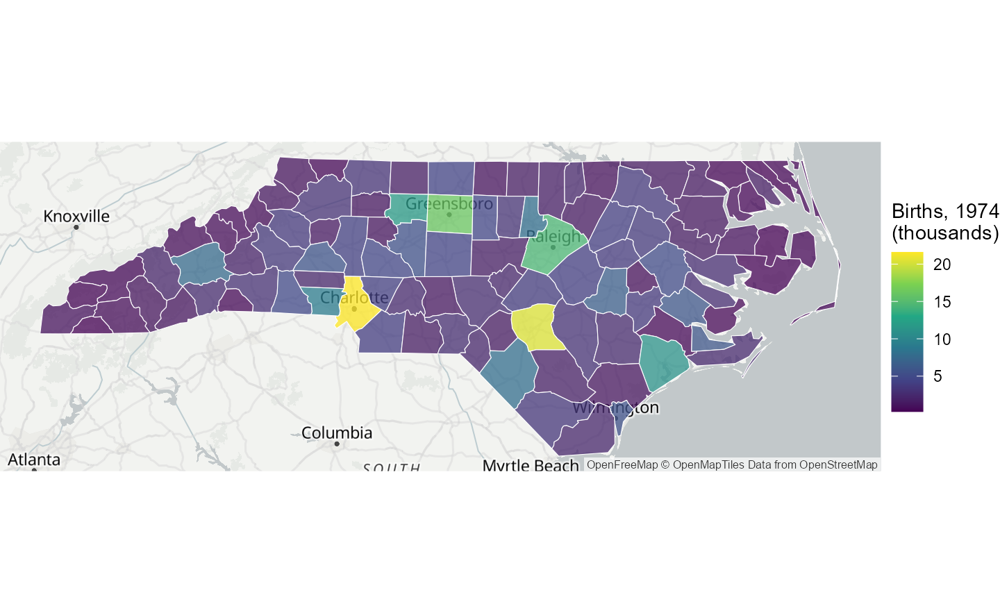
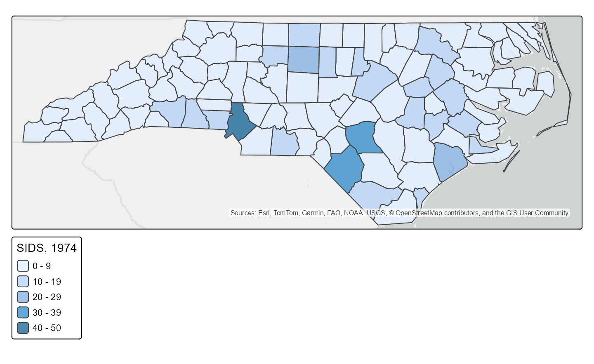

# Get started

> **Python or Rust?** The same functions and arguments exist in
> [Python](https://ar-puuk.github.io/basemapper/python/index.md)
> (`m.verb(...)` for R’s `verb(m, ...)`) and
> [Rust](https://ar-puuk.github.io/basemapper/rust/basemapper_core/index.md).

basemapper renders MapLibre GL basemaps headlessly with a Rust core: no
browser, display server, GPU or GDAL. Vector styles are drawn by a
software port of MapLibre GL JS’s renderer, so maps look as they do in
MapLibre. Everything on this page was run when the page was built; the
maps are the output of the code above them.

## Installation

\
`# Any one of these; each compiles the Rust core from source.`\
`pak``::`[`pak`](https://pak.r-lib.org/reference/pak.html)`(``"ar-puuk/basemapper/r-basemapper"``)`\
`remotes``::`[`install_github`](https://remotes.r-lib.org/reference/install_github.html)`(``"ar-puuk/basemapper"``, subdir ``=`` ``"r-basemapper"``)`\
`devtools``::``install_github``(``"ar-puuk/basemapper"``, subdir ``=`` ``"r-basemapper"``)`

## Choose a style

Every function takes a `style`. The simplest is a named basemap, a
[leaflet-providers](https://leaflet-extras.github.io/leaflet-providers/preview/)
name;
[`list_providers()`](https://ar-puuk.github.io/basemapper/r/reference/list_providers.md)
lists them, with the API key some need:

\
[`library`](https://rdrr.io/r/base/library.html)`(`[`tmap`](https://github.com/r-tmap/tmap)`)``        ``# (for the tmap example below) before basemapper,`\
[`library`](https://rdrr.io/r/base/library.html)`(`[`basemapper`](https://ar-puuk.github.io/basemapper/r/)`)``  ``# whose tm_basemap() replaces tmap's`\
`#> `\
`#> Attaching package: 'basemapper'`\
`#> The following object is masked from 'package:tmap':`\
`#> `\
`#>     tm_basemap`\
\
`p`` ``<-`` `[`list_providers`](https://ar-puuk.github.io/basemapper/r/reference/list_providers.md)`(``)`\
[`head`](https://rdrr.io/r/utils/head.html)`(``p``[``, `[`c`](https://rdrr.io/r/base/c.html)`(``"name"``, ``"vector"``, ``"raster"``, ``"api_key_env"``)``]``, ``12``)`\
`#>                    name vector raster   api_key_env`\
`#> 1  OpenStreetMap.Mapnik  FALSE   TRUE          <NA>`\
`#> 2      OpenStreetMap.DE  FALSE   TRUE          <NA>`\
`#> 3  OpenStreetMap.France  FALSE   TRUE          <NA>`\
`#> 4     OpenStreetMap.HOT  FALSE   TRUE          <NA>`\
`#> 5           OpenTopoMap  FALSE   TRUE          <NA>`\
`#> 6               CyclOSM  FALSE   TRUE          <NA>`\
`#> 7   OpenFreeMap.Liberty   TRUE  FALSE          <NA>`\
`#> 8    OpenFreeMap.Bright   TRUE  FALSE          <NA>`\
`#> 9  OpenFreeMap.Positron   TRUE  FALSE          <NA>`\
`#> 10     OpenFreeMap.Dark   TRUE  FALSE          <NA>`\
`#> 11    OpenFreeMap.Fiord   TRUE  FALSE          <NA>`\
`#> 12     CartoDB.Positron   TRUE   TRUE CARTO_API_KEY`

A MapLibre style URL or JSON works too, and so does tile data: a tile
URL, TileJSON, PMTiles archive or ArcGIS service (see [Your own tiles
and
services](https://ar-puuk.github.io/basemapper/r/articles/own-data.md)).

## A map on its own

[`basemap()`](https://ar-puuk.github.io/basemapper/r/reference/basemap.md)
creates a view: a centre and MapLibre zoom (or bounds to fit), and a
size in CSS pixels. Printed in a document, a view shows the map:

\
`m`` ``<-`` `[`basemap`](https://ar-puuk.github.io/basemapper/r/reference/basemap.md)`(``"OpenFreeMap.Positron"``, ``720``, ``405``, center ``=`` `[`c`](https://rdrr.io/r/base/c.html)`(``-``111.8887``, ``40.7556``)``, zoom ``=`` ``12.4``)`\
`m`

[`print()`](https://rdrr.io/r/base/print.html) describes it, and the
`get_*()` functions read it:

\
[`print`](https://rdrr.io/r/base/print.html)`(``m``)`\
`#> <basemap> 1 style, 720 x 405 @ 1x (720 x 405 px), center (-111.88870, 40.75560), zoom 12.400`\
[`get_bounds`](https://ar-puuk.github.io/basemapper/r/reference/get_bounds.md)`(``m``, lonlat ``=`` ``TRUE``)`\
`#>       xmin       ymin       xmax       ymax `\
`#> -111.93553   40.73564 -111.84187   40.77555`\
[`get_attribution`](https://ar-puuk.github.io/basemapper/r/reference/get_attribution.md)`(``m``)`\
`#> [1] "OpenFreeMap © OpenMapTiles Data from OpenStreetMap"`

[`set_view()`](https://ar-puuk.github.io/basemapper/r/reference/set_view.md)
and
[`set_bounds()`](https://ar-puuk.github.io/basemapper/r/reference/set_view.md)
change the view. Here it fits North Carolina’s counties, from {sf}:

\
`nc`` ``<-`` ``sf``::`[`st_read`](https://r-spatial.github.io/sf/reference/st_read.html)`(`[`system.file`](https://rdrr.io/r/base/system.file.html)`(``"shape/nc.shp"``, package ``=`` ``"sf"``)``, quiet ``=`` ``TRUE``)`\
`m`` ``<-`` `[`set_bounds`](https://ar-puuk.github.io/basemapper/r/reference/set_view.md)`(`[`basemap`](https://ar-puuk.github.io/basemapper/r/reference/basemap.md)`(``"OpenFreeMap.Liberty"``, ``720``, ``300``)``, ``nc``)`\
`m`

## Raster and vector, PNG and SVG

Basemaps come as raster tiles (images, like OpenStreetMap’s) or vector
tiles (geometry styled on the fly, like OpenFreeMap’s). Either renders
to a PNG with
[`render_png()`](https://ar-puuk.github.io/basemapper/r/reference/render_png.md)
or an SVG with
[`render_svg()`](https://ar-puuk.github.io/basemapper/r/reference/render_png.md).
In an SVG, vector layers are paths and the labels editable text with the
style’s fonts embedded; raster tiles are embedded as images.

\
`slc`` ``<-`` `[`c`](https://rdrr.io/r/base/c.html)`(``-``111.8910``, ``40.7608``)`\
`raster`` ``<-`` `[`basemap`](https://ar-puuk.github.io/basemapper/r/reference/basemap.md)`(``"OpenStreetMap.Mapnik"``, ``480``, ``300``, center ``=`` ``slc``, zoom ``=`` ``11.5``)`\
`vector`` ``<-`` `[`basemap`](https://ar-puuk.github.io/basemapper/r/reference/basemap.md)`(``"OpenFreeMap.Bright"``, ``480``, ``300``, center ``=`` ``slc``, zoom ``=`` ``11.5``)`\
\
`out`` ``<-`` `[`file.path`](https://rdrr.io/r/base/file.path.html)`(`[`tempdir`](https://rdrr.io/r/base/tempfile.html)`(``)``, `[`c`](https://rdrr.io/r/base/c.html)`(``"raster.png"``, ``"raster.svg"``, ``"vector.png"``, ``"vector.svg"``)``)`\
[`render_png`](https://ar-puuk.github.io/basemapper/r/reference/render_png.md)`(``raster``, path ``=`` ``out``[``1``]``)`\
[`render_svg`](https://ar-puuk.github.io/basemapper/r/reference/render_png.md)`(``raster``, path ``=`` ``out``[``2``]``)`\
[`render_png`](https://ar-puuk.github.io/basemapper/r/reference/render_png.md)`(``vector``, path ``=`` ``out``[``3``]``)`\
[`render_svg`](https://ar-puuk.github.io/basemapper/r/reference/render_png.md)`(``vector``, path ``=`` ``out``[``4``]``)`\
[`data.frame`](https://rdrr.io/r/base/data.frame.html)`(``file ``=`` `[`basename`](https://rdrr.io/r/base/basename.html)`(``out``)``, kb ``=`` `[`round`](https://rdrr.io/r/base/Round.html)`(`[`file.size`](https://rdrr.io/r/base/file.info.html)`(``out``)`` ``/`` ``1024``)``)`\
`#>         file  kb`\
`#> 1 raster.png 229`\
`#> 2 raster.svg 306`\
`#> 3 vector.png  82`\
`#> 4 vector.svg 430`

[TABLE]

[`render_raster()`](https://ar-puuk.github.io/basemapper/r/reference/render_png.md)
returns a georeferenced {terra} raster, and
[`render_array()`](https://ar-puuk.github.io/basemapper/r/reference/render_png.md)
the pixels:

\
[`render_raster`](https://ar-puuk.github.io/basemapper/r/reference/render_png.md)`(``vector``)`\
`#> class       : SpatRaster`\
`#> size        : 300, 480, 4  (nrow, ncol, nlyr)`\
`#> resolution  : 27.02457, 27.02457  (x, y)`\
`#> extent      : -1.246214e+07, -1.244916e+07, 4973070, 4981177  (xmin, xmax, ymin, ymax)`\
`#> coord. ref. : WGS 84 / Pseudo-Mercator (EPSG:3857)`\
`#> source(s)   : memory`\
`#> colors rgb  : 1, 2, 3`\
`#> names       : red, green, blue, alpha`\
`#> min values  :   6,     6,    6,   255`\
`#> max values  : 255,   255,  255,   255`\
[`dim`](https://rdrr.io/r/base/dim.html)`(`[`render_array`](https://ar-puuk.github.io/basemapper/r/reference/render_png.md)`(``vector``)``)`\
`#> [1] 300 480   4`

`pixel_ratio` makes images larger with the same view and label layout:
`pixel_ratio = 2` for a sharp 2x image, `dpi / 96` for print.

## In a plot

[`geom_basemap()`](https://ar-puuk.github.io/basemapper/r/reference/geom_basemap.md)
adds a basemap to a {ggplot2} plot. It renders when the plot is drawn,
for the panel’s extent and at the device’s resolution, and credits the
provider in the corner:

\
[`library`](https://rdrr.io/r/base/library.html)`(`[`ggplot2`](https://ggplot2.tidyverse.org)`)`\
\
[`ggplot`](https://ggplot2.tidyverse.org/reference/ggplot.html)`(``nc``)`` ``+`\
`  `[`geom_basemap`](https://ar-puuk.github.io/basemapper/r/reference/geom_basemap.md)`(``"OpenFreeMap.Positron"``)`` ``+`\
`  `[`geom_sf`](https://ggplot2.tidyverse.org/reference/ggsf.html)`(`[`aes`](https://ggplot2.tidyverse.org/reference/aes.html)`(``fill ``=`` ``BIR74`` ``/`` ``1000``)``, colour ``=`` ``"white"``, linewidth ``=`` ``0.2``, alpha ``=`` ``0.75``)`` ``+`\
`  `[`scale_fill_viridis_c`](https://ggplot2.tidyverse.org/reference/scale_viridis.html)`(``"Births, 1974\n(thousands)"``)`` ``+`\
`  `[`theme_void`](https://ggplot2.tidyverse.org/reference/ggtheme.html)`(``)`

[`tm_basemap()`](https://ar-puuk.github.io/basemapper/r/reference/tm_basemap.md)
does the same in {tmap} (attach tmap first: it has a
[`tm_basemap()`](https://ar-puuk.github.io/basemapper/r/reference/tm_basemap.md)
of its own):

\
[`tm_shape`](https://r-tmap.github.io/tmap/reference/tm_shape.html)`(``nc``)`` ``+`\
`  `[`tm_basemap`](https://ar-puuk.github.io/basemapper/r/reference/tm_basemap.md)`(``"Esri.WorldGrayCanvas"``)`` ``+`\
`  `[`tm_polygons`](https://r-tmap.github.io/tmap/reference/tm_polygons.html)`(``fill ``=`` ``"SID74"``, fill_alpha ``=`` ``0.7``, fill.legend ``=`` `[`tm_legend`](https://r-tmap.github.io/tmap/reference/tm_legend.html)`(``"SIDS, 1974"``)``)`

[Plots with ggplot2 and
tmap](https://ar-puuk.github.io/basemapper/r/articles/plotting.md) has
more.

## Next

- [Basemap
  gallery](https://ar-puuk.github.io/basemapper/r/articles/gallery.md):
  every basemap that needs no API key.
- [Plots with ggplot2 and
  tmap](https://ar-puuk.github.io/basemapper/r/articles/plotting.md):
  projected data, opacity, credits and print resolution.
- [Stacking, labels and
  features](https://ar-puuk.github.io/basemapper/r/articles/layers.md):
  several basemaps in one, and parts of them.
- [Your own tiles and
  services](https://ar-puuk.github.io/basemapper/r/articles/own-data.md):
  tile URLs, PMTiles, ArcGIS and OGC services, and styles for your own
  data.
