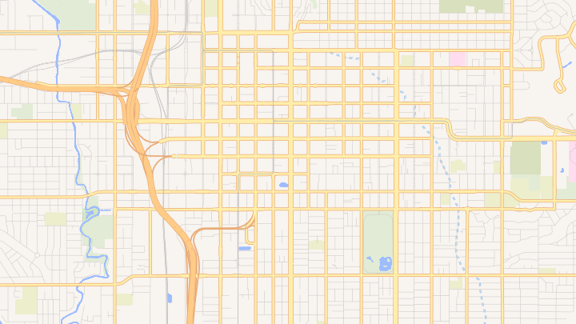
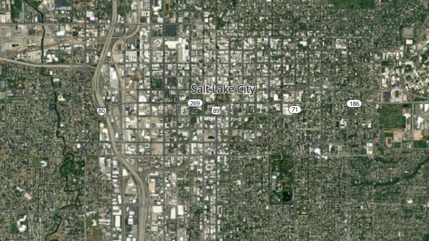
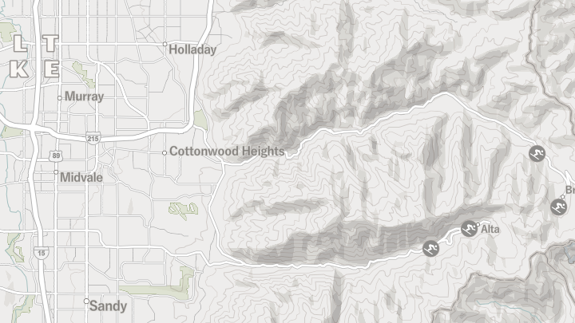
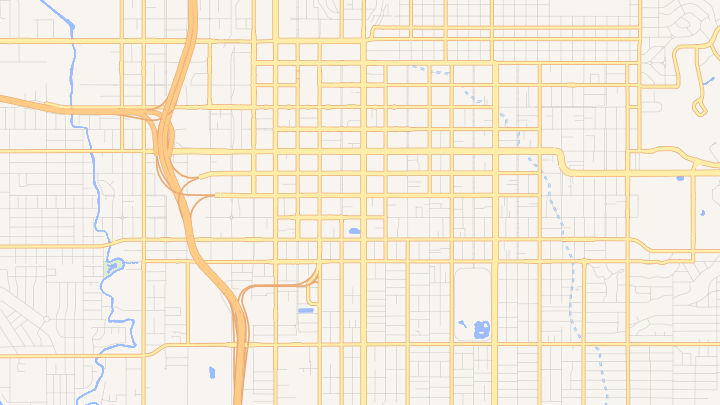
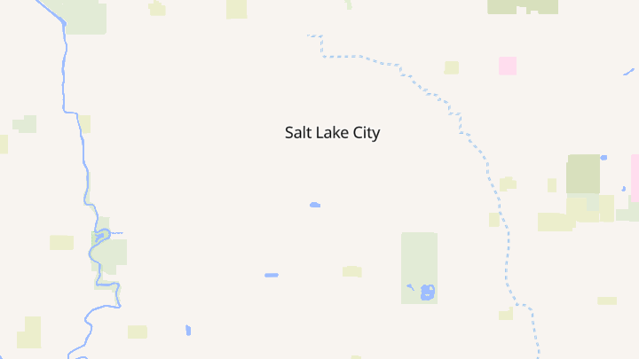
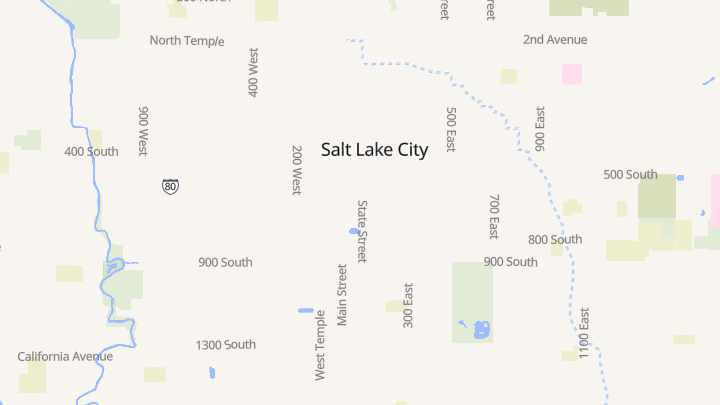
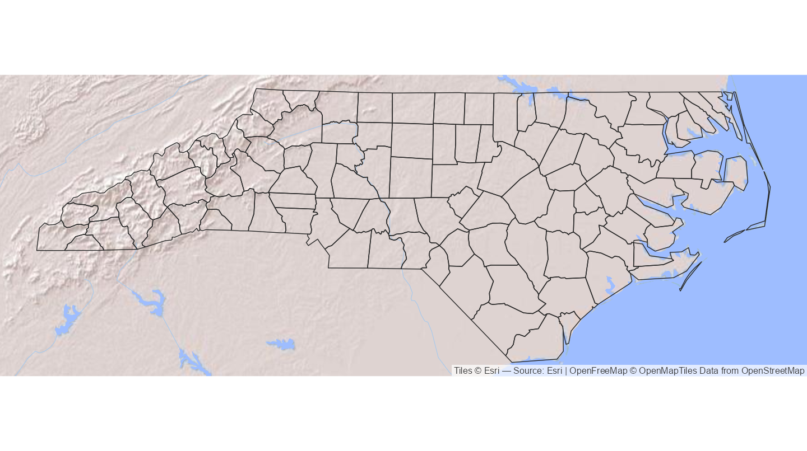

# Stacking, labels and features

A style is a stack of layers: background, water, roads, labels and so
on. basemapper can draw only some of them, and can stack several styles
into one map.

\
[`library`](https://rdrr.io/r/base/library.html)`(`[`basemapper`](https://ar-puuk.github.io/basemapper/r/)`)`\
`slc`` ``<-`` `[`c`](https://rdrr.io/r/base/c.html)`(``-``111.8887``, ``40.7556``)`\
`view`` ``<-`` ``function``(``style``, ``...``)`` `[`basemap`](https://ar-puuk.github.io/basemapper/r/reference/basemap.md)`(``style``, ``720``, ``405``, center ``=`` ``slc``, zoom ``=`` ``12.4``, ``...``)`

## What a style draws

[`list_layers()`](https://ar-puuk.github.io/basemapper/r/reference/list_layers.md)
lists a style’s layers in drawing order, with the vector tile layer each
one draws (`source_layer`) and the *feature* it shows:

\
`l`` ``<-`` `[`list_layers`](https://ar-puuk.github.io/basemapper/r/reference/list_layers.md)`(``"OpenFreeMap.Liberty"``)`\
[`nrow`](https://rdrr.io/r/base/nrow.html)`(``l``)`\
`#> [1] 111`\
[`head`](https://rdrr.io/r/utils/head.html)`(``l``, ``10``)`\
`#>                     id       type source_layer    feature`\
`#> 1           background background         <NA> background`\
`#> 2        natural_earth     raster         <NA>    terrain`\
`#> 3                 park       fill         park      parks`\
`#> 4         park_outline       line         park      parks`\
`#> 5  landuse_residential       fill      landuse  landcover`\
`#> 6       landcover_wood       fill    landcover  landcover`\
`#> 7      landcover_grass       fill    landcover  landcover`\
`#> 8        landcover_ice       fill    landcover  landcover`\
`#> 9    landcover_wetland       fill    landcover  landcover`\
`#> 10       landuse_pitch       fill      landuse  landcover`\
[`table`](https://rdrr.io/r/base/table.html)`(``l``$``feature``)`\
`#> `\
`#> background boundaries  buildings  landcover      parks     places        poi `\
`#>          1          3          2         11          2          9          5 `\
`#>       rail      roads    terrain      water `\
`#>         12         58          1          7`

## Labels

`labels = FALSE` draws a style without its labels (text and icons):

\
`view``(``"OpenFreeMap.Liberty"``, labels ``=`` ``FALSE``)`

`labels = "only"` draws just the labels, on a transparent background, to
go over another map.

## Stacking

A vector of styles is drawn bottom to top. To filter one style of a
stack, give the filter to
[`basemap_provider()`](https://ar-puuk.github.io/basemapper/r/reference/basemap_provider.md);
this puts satellite imagery under a vector basemap’s labels:

\
`hybrid`` ``<-`` `[`c`](https://rdrr.io/r/base/c.html)`(``"Esri.WorldImagery"``, `[`basemap_provider`](https://ar-puuk.github.io/basemapper/r/reference/basemap_provider.md)`(``"OpenFreeMap.Liberty"``, labels ``=`` ``"only"``)``)`\
`view``(``hybrid``)`

ArcGIS basemaps are often published as separate services, drawn in
order. The Utah Geospatial Resource Center’s *Lite* basemap is a
hillshade, a base map and labels:

\
`ugrc`` ``<-`` ``"https://tiles.arcgis.com/tiles/99lidPhWCzftIe9K/arcgis/rest/services"`\
`lite`` ``<-`` `[`file.path`](https://rdrr.io/r/base/file.path.html)`(``ugrc``, `[`c`](https://rdrr.io/r/base/c.html)`(``"VectorHillshade"``, ``"LiteBase"``, ``"LiteLabels"``)``, ``"VectorTileServer/resources/styles/root.json"``)`\
[`basemap`](https://ar-puuk.github.io/basemapper/r/reference/basemap.md)`(``lite``, ``720``, ``405``, center ``=`` `[`c`](https://rdrr.io/r/base/c.html)`(``-``111.75``, ``40.62``)``, zoom ``=`` ``10.5``)`

## Features

`features` keeps or drops parts of the map by what they show:
background, water, landcover, parks, buildings, roads, rail, boundaries,
places, poi and terrain. Plain names keep, `"-name"` drops.

\
`view``(``"OpenFreeMap.Liberty"``, labels ``=`` ``FALSE``, features ``=`` `[`c`](https://rdrr.io/r/base/c.html)`(``"background"``, ``"water"``, ``"parks"``, ``"roads"``)``)`

\
`view``(``"OpenFreeMap.Liberty"``, features ``=`` `[`c`](https://rdrr.io/r/base/c.html)`(``"-roads"``, ``"-rail"``, ``"-poi"``)``)`

[`list_layers()`](https://ar-puuk.github.io/basemapper/r/reference/list_layers.md)
takes the same filters and lists what a render with them draws, to check
a filter before rendering:

\
[`list_layers`](https://ar-puuk.github.io/basemapper/r/reference/list_layers.md)`(``"OpenFreeMap.Liberty"``, labels ``=`` ``FALSE``, features ``=`` `[`c`](https://rdrr.io/r/base/c.html)`(``"water"``, ``"parks"``)``)`\
`#>                id type source_layer feature`\
`#> 1            park fill         park   parks`\
`#> 2    park_outline line         park   parks`\
`#> 3 waterway_tunnel line     waterway   water`\
`#> 4  waterway_river line     waterway   water`\
`#> 5  waterway_other line     waterway   water`\
`#> 6           water fill        water   water`

## Layers

Features are sorted from each layer’s source layer, as a convenience.
For exact control, `layers` keeps layers by id, or drops them with
`"-"`; `*` and `?` are wildcards:

\
`view``(``"OpenFreeMap.Liberty"``, layers ``=`` `[`c`](https://rdrr.io/r/base/c.html)`(``"-road_*"``, ``"-bridge_*"``, ``"-tunnel_*"``)``)`

A name that matches no layer warns, so a typo does not go unnoticed:

\
`m`` ``<-`` ``view``(``"OpenFreeMap.Liberty"``, layers ``=`` ``"-lable_village"``)`\
[`invisible`](https://rdrr.io/r/base/invisible.html)`(`[`render_array`](https://ar-puuk.github.io/basemapper/r/reference/render_png.md)`(``m``)``)`\
`#> Warning: layers: "-lable_village" matches no layer`

## In plots

The plot layers take the same arguments:

\
[`library`](https://rdrr.io/r/base/library.html)`(`[`ggplot2`](https://ggplot2.tidyverse.org)`)`\
`nc`` ``<-`` ``sf``::`[`st_read`](https://r-spatial.github.io/sf/reference/st_read.html)`(`[`system.file`](https://rdrr.io/r/base/system.file.html)`(``"shape/nc.shp"``, package ``=`` ``"sf"``)``, quiet ``=`` ``TRUE``)`\
\
[`ggplot`](https://ggplot2.tidyverse.org/reference/ggplot.html)`(``nc``)`` ``+`\
`  `[`geom_basemap`](https://ar-puuk.github.io/basemapper/r/reference/geom_basemap.md)`(`[`c`](https://rdrr.io/r/base/c.html)`(``"Esri.WorldShadedRelief"``, `[`basemap_provider`](https://ar-puuk.github.io/basemapper/r/reference/basemap_provider.md)`(``"OpenFreeMap.Liberty"``, features ``=`` ``"water"``, labels ``=`` ``FALSE``)``)``)`` ``+`\
`  `[`geom_sf`](https://ggplot2.tidyverse.org/reference/ggsf.html)`(``fill ``=`` ``NA``, colour ``=`` ``"grey15"``, linewidth ``=`` ``0.25``)`` ``+`\
`  `[`theme_void`](https://ggplot2.tidyverse.org/reference/ggtheme.html)`(``)`

