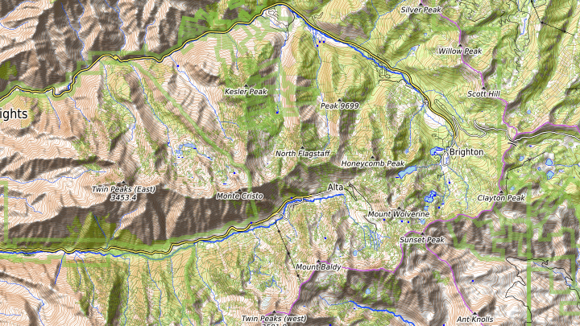
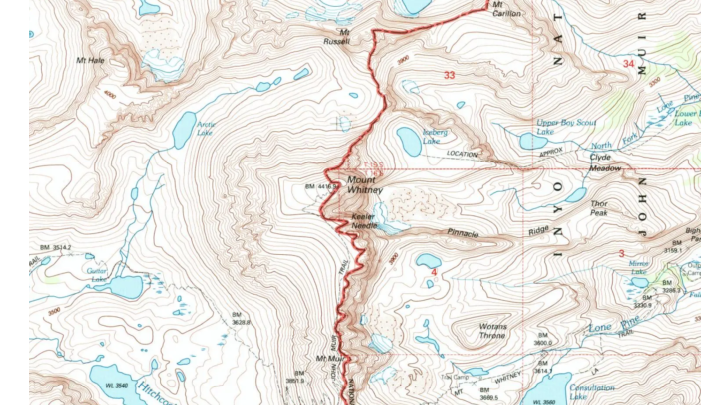
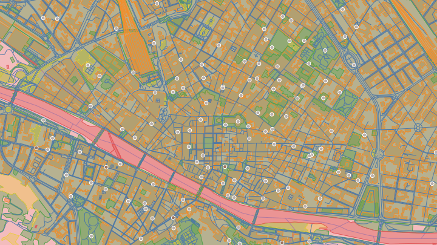
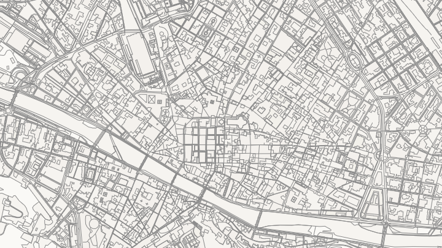
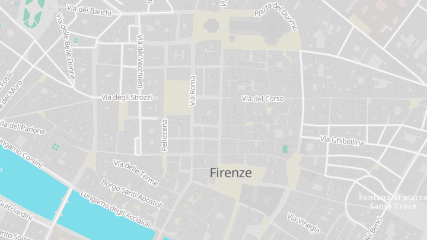
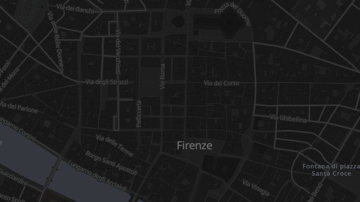
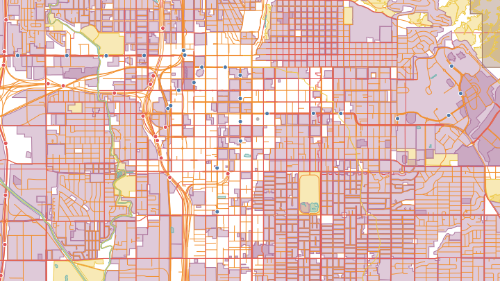
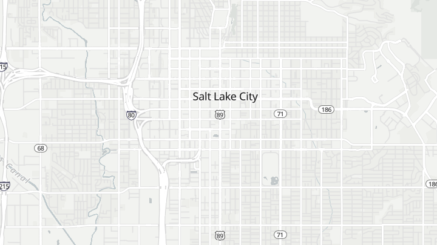
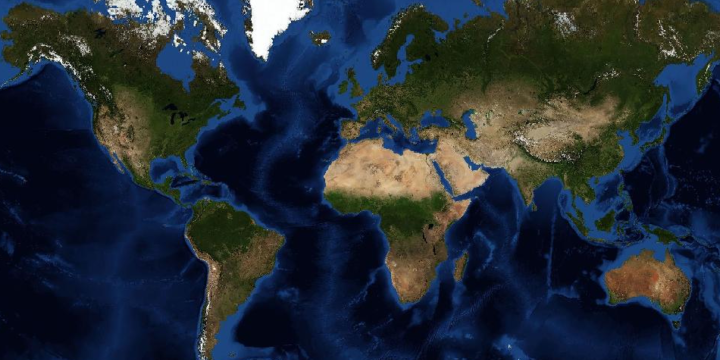
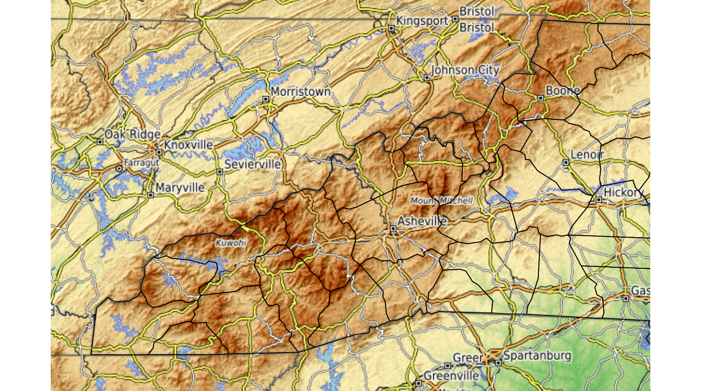

# Your own tiles and services

Besides named basemaps and MapLibre styles, `style` takes tile data: a
tile URL template, TileJSON, a PMTiles archive (URL or local file), or
an ArcGIS service. basemapper detects whether the tiles are raster or
vector and builds a style for them;
[`tile_style()`](https://ar-puuk.github.io/basemapper/r/reference/tile_style.md)
builds one with your overrides. OGC services (WMS, WMTS) have their own
style builders.

\
[`library`](https://rdrr.io/r/base/library.html)`(`[`basemapper`](https://ar-puuk.github.io/basemapper/r/)`)`

## A tile URL

An XYZ template, as raster tiles:

\
[`basemap`](https://ar-puuk.github.io/basemapper/r/reference/basemap.md)`(``"https://tile.opentopomap.org/{z}/{x}/{y}.png"``, ``720``, ``405``,`\
`        center ``=`` `[`c`](https://rdrr.io/r/base/c.html)`(``-``111.65``, ``40.60``)``, zoom ``=`` ``11``)`

## PMTiles

A [PMTiles](https://docs.protomaps.com/pmtiles/) archive is read with
HTTP range requests, or from a local file. Raster archives draw as they
are; here a USGS topographic map of Mount Whitney, fitted to the
archive’s extent:

\
[`basemap`](https://ar-puuk.github.io/basemapper/r/reference/basemap.md)`(``"https://pmtiles.io/usgs-mt-whitney-8-15-webp-512.pmtiles"``, ``720``, ``405``,`\
`        bounds ``=`` `[`c`](https://rdrr.io/r/base/c.html)`(``-``118.3198``, ``36.5611``, ``-``118.2607``, ``36.5930``)``)`

Vector archives get a default style over every source layer:

\
`firenze`` ``<-`` ``"https://pmtiles.io/protomaps(vector)ODbL_firenze.pmtiles"`\
[`basemap`](https://ar-puuk.github.io/basemapper/r/reference/basemap.md)`(``firenze``, ``720``, ``405``, center ``=`` `[`c`](https://rdrr.io/r/base/c.html)`(``11.255``, ``43.773``)``, zoom ``=`` ``13.5``)`

[`tile_style()`](https://ar-puuk.github.io/basemapper/r/reference/tile_style.md)
sets which source layers it draws, and its paint:

\
[`list_layers`](https://ar-puuk.github.io/basemapper/r/reference/list_layers.md)`(``firenze``)``[``, `[`c`](https://rdrr.io/r/base/c.html)`(``"id"``, ``"type"``, ``"source_layer"``)``]`\
`#>                       id   type   source_layer`\
`#> 1        boundaries-fill   fill     boundaries`\
`#> 2         buildings-fill   fill      buildings`\
`#> 3             earth-fill   fill          earth`\
`#> 4         landcover-fill   fill      landcover`\
`#> 5           landuse-fill   fill        landuse`\
`#> 6           natural-fill   fill        natural`\
`#> 7     physical_line-fill   fill  physical_line`\
`#> 8    physical_point-fill   fill physical_point`\
`#> 9            places-fill   fill         places`\
`#> 10             pois-fill   fill           pois`\
`#> 11            roads-fill   fill          roads`\
`#> 12          transit-fill   fill        transit`\
`#> 13            water-fill   fill          water`\
`#> 14       boundaries-line   line     boundaries`\
`#> 15        buildings-line   line      buildings`\
`#> 16            earth-line   line          earth`\
`#> 17        landcover-line   line      landcover`\
`#> 18          landuse-line   line        landuse`\
`#> 19          natural-line   line        natural`\
`#> 20    physical_line-line   line  physical_line`\
`#> 21   physical_point-line   line physical_point`\
`#> 22           places-line   line         places`\
`#> 23             pois-line   line           pois`\
`#> 24            roads-line   line          roads`\
`#> 25          transit-line   line        transit`\
`#> 26            water-line   line          water`\
`#> 27     boundaries-circle circle     boundaries`\
`#> 28      buildings-circle circle      buildings`\
`#> 29          earth-circle circle          earth`\
`#> 30      landcover-circle circle      landcover`\
`#> 31        landuse-circle circle        landuse`\
`#> 32        natural-circle circle        natural`\
`#> 33  physical_line-circle circle  physical_line`\
`#> 34 physical_point-circle circle physical_point`\
`#> 35         places-circle circle         places`\
`#> 36           pois-circle circle           pois`\
`#> 37          roads-circle circle          roads`\
`#> 38        transit-circle circle        transit`\
`#> 39          water-circle circle          water`\
\
`styled`` ``<-`` `[`tile_style`](https://ar-puuk.github.io/basemapper/r/reference/tile_style.md)`(`\
`  ``firenze``,`\
`  source_layers ``=`` `[`c`](https://rdrr.io/r/base/c.html)`(``"earth"``, ``"water"``, ``"landuse"``, ``"roads"``, ``"buildings"``)``,`\
`  paint ``=`` `[`list`](https://rdrr.io/r/base/list.html)`(``"fill-color"`` ``=`` ``"#f2efe9"``, ``"line-color"`` ``=`` ``"#8a8a8a"``)`\
`)`\
[`basemap`](https://ar-puuk.github.io/basemapper/r/reference/basemap.md)`(``styled``, ``720``, ``405``, center ``=`` `[`c`](https://rdrr.io/r/base/c.html)`(``11.255``, ``43.773``)``, zoom ``=`` ``13.5``)`

### With a basemap style

A vector archive can also be drawn with a full basemap style whose
source points at it.
[protomaps-light.json](https://ar-puuk.github.io/basemapper/styles/protomaps-light.json)
and
[protomaps-dark.json](https://ar-puuk.github.io/basemapper/styles/protomaps-dark.json)
are the [Protomaps](https://github.com/protomaps/basemaps) basemap
styles with the Florence archive as their source
(`"url": "pmtiles://https://pmtiles.io/protomaps(vector)ODbL_firenze.pmtiles"`),
and a style file’s path works as `style`:

\
[`basemap`](https://ar-puuk.github.io/basemapper/r/reference/basemap.md)`(``"styles/protomaps-light.json"``, ``720``, ``405``, center ``=`` `[`c`](https://rdrr.io/r/base/c.html)`(``11.2551``, ``43.7710``)``, zoom ``=`` ``15.2``)`

\
[`basemap`](https://ar-puuk.github.io/basemapper/r/reference/basemap.md)`(``"styles/protomaps-dark.json"``, ``720``, ``405``, center ``=`` `[`c`](https://rdrr.io/r/base/c.html)`(``11.2551``, ``43.7710``)``, zoom ``=`` ``15.2``)`

For your own Protomaps archive, change the source’s `url` to
`pmtiles://` and the archive’s URL or path. These styles are for
Protomaps tiles v3; archives built from late 2024 on use tiles v4, with
the styles of `@protomaps/basemaps` 5 ([how the styles were
made](https://ar-puuk.github.io/basemapper/styles/README.md)).

## TileJSON

A TileJSON URL works the same way; this is OpenFreeMap’s planet tileset,
with the default vector style:

\
[`basemap`](https://ar-puuk.github.io/basemapper/r/reference/basemap.md)`(``"https://tiles.openfreemap.org/planet"``, ``720``, ``405``,`\
`        center ``=`` `[`c`](https://rdrr.io/r/base/c.html)`(``-``111.8887``, ``40.7556``)``, zoom ``=`` ``12``)`

## Your tiles in a basemap’s style

`basemap_provider(name, tiles =)` keeps a basemap’s style and swaps in
your own tiles, which must use the same schema (OpenFreeMap’s styles use
OpenMapTiles): self-hosted tiles, or an extract for offline use.

\
`style`` ``<-`` `[`basemap_provider`](https://ar-puuk.github.io/basemapper/r/reference/basemap_provider.md)`(``"OpenFreeMap.Positron"``, tiles ``=`` ``"https://tiles.openfreemap.org/planet"``)`\
[`basemap`](https://ar-puuk.github.io/basemapper/r/reference/basemap.md)`(``style``, ``720``, ``405``, center ``=`` `[`c`](https://rdrr.io/r/base/c.html)`(``-``111.8887``, ``40.7556``)``, zoom ``=`` ``12``)`

## OGC services

[`wms_style()`](https://ar-puuk.github.io/basemapper/r/reference/ogc_styles.md)
and
[`wmts_style()`](https://ar-puuk.github.io/basemapper/r/reference/ogc_styles.md)
build styles for OGC services. NASA’s Blue Marble, from GIBS:

\
`gibs`` ``<-`` `[`wms_style`](https://ar-puuk.github.io/basemapper/r/reference/ogc_styles.md)`(``"https://gibs.earthdata.nasa.gov/wms/epsg3857/best/wms.cgi"``,`\
`                  layers ``=`` ``"BlueMarble_ShadedRelief_Bathymetry"``, format ``=`` ``"image/jpeg"``)`\
[`basemap`](https://ar-puuk.github.io/basemapper/r/reference/basemap.md)`(``gibs``, ``720``, ``360``, center ``=`` `[`c`](https://rdrr.io/r/base/c.html)`(``0``, ``20``)``, zoom ``=`` ``0.6``)`

## In plots

Any of these goes in
[`geom_basemap()`](https://ar-puuk.github.io/basemapper/r/reference/geom_basemap.md)
and
[`tm_basemap()`](https://ar-puuk.github.io/basemapper/r/reference/tm_basemap.md):

\
[`library`](https://rdrr.io/r/base/library.html)`(`[`ggplot2`](https://ggplot2.tidyverse.org)`)`\
`nc`` ``<-`` ``sf``::`[`st_read`](https://r-spatial.github.io/sf/reference/st_read.html)`(`[`system.file`](https://rdrr.io/r/base/system.file.html)`(``"shape/nc.shp"``, package ``=`` ``"sf"``)``, quiet ``=`` ``TRUE``)`\
\
[`ggplot`](https://ggplot2.tidyverse.org/reference/ggplot.html)`(``nc``)`` ``+`\
`  `[`geom_basemap`](https://ar-puuk.github.io/basemapper/r/reference/geom_basemap.md)`(``"https://tile.opentopomap.org/{z}/{x}/{y}.png"``, alpha ``=`` ``0.8``)`` ``+`\
`  `[`geom_sf`](https://ggplot2.tidyverse.org/reference/ggsf.html)`(``fill ``=`` ``NA``, colour ``=`` ``"black"``, linewidth ``=`` ``0.3``)`` ``+`\
`  `[`coord_sf`](https://ggplot2.tidyverse.org/reference/ggsf.html)`(``xlim ``=`` `[`c`](https://rdrr.io/r/base/c.html)`(``-``84.4``, ``-``81.2``)``, ylim ``=`` `[`c`](https://rdrr.io/r/base/c.html)`(``34.9``, ``36.6``)``)`` ``+`\
`  `[`theme_void`](https://ggplot2.tidyverse.org/reference/ggtheme.html)`(``)`

## Tile cache

Tiles are cached on disk, for as long as the servers’ caching headers
allow.
[`tile_cache()`](https://ar-puuk.github.io/basemapper/r/reference/tile_cache.md)
shows where; `tile_cache(clear = TRUE)` empties it, and
`tile_cache(FALSE)` turns it off for the session.
