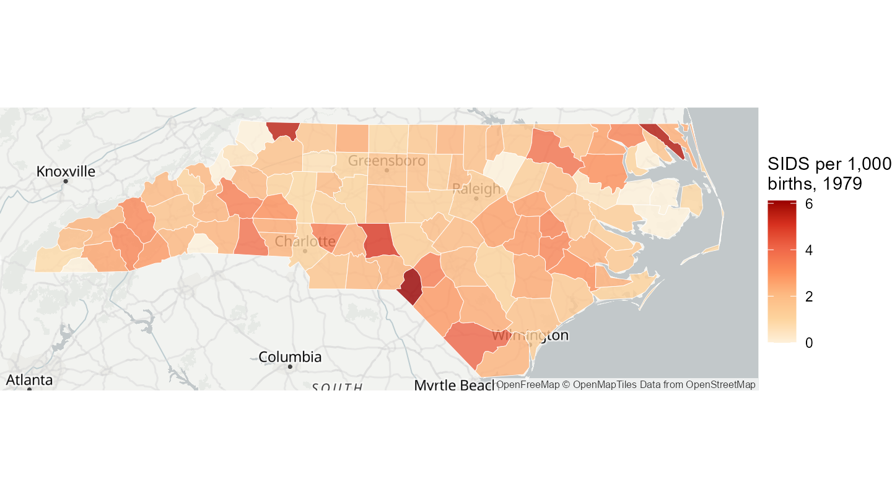
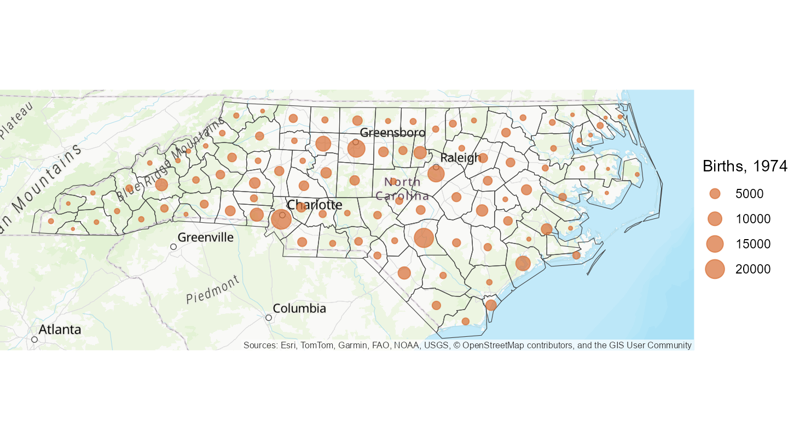
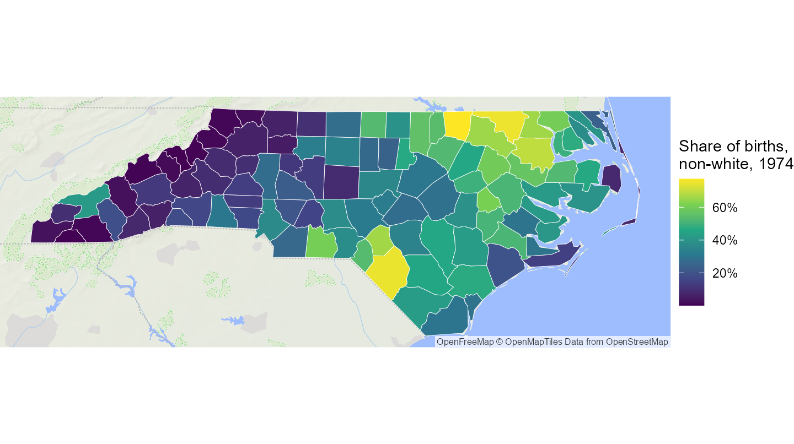
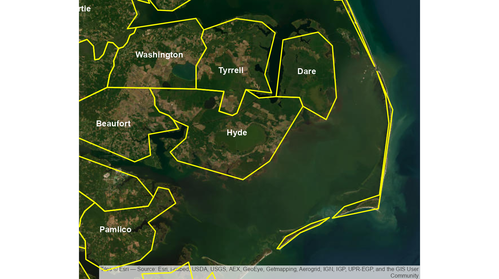
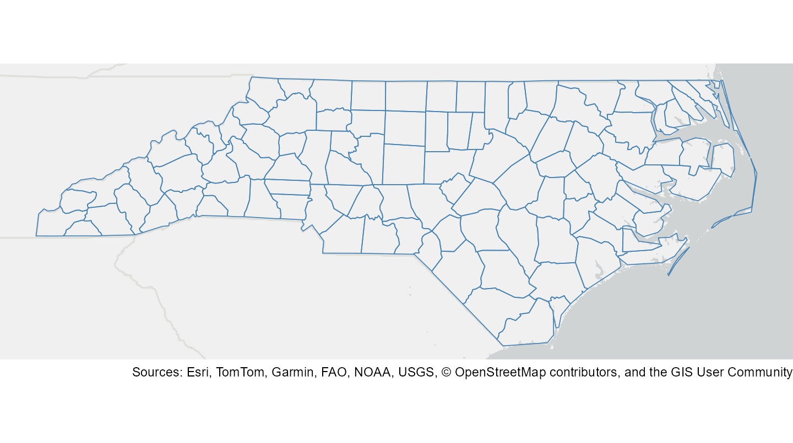
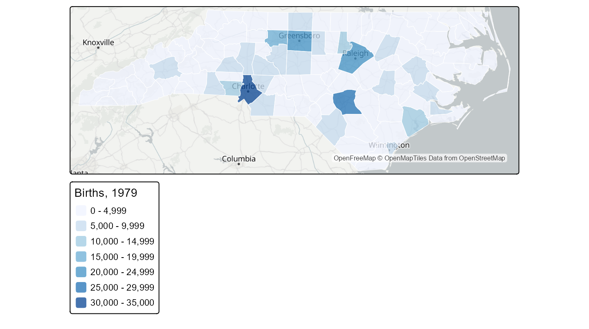
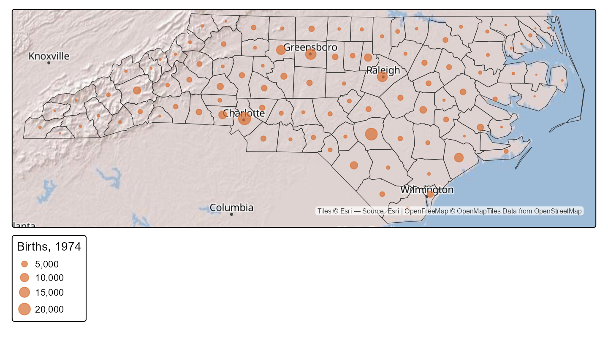

# Plots with ggplot2 and tmap

[`geom_basemap()`](https://ar-puuk.github.io/basemapper/r/reference/geom_basemap.md)
({ggplot2}) and
[`tm_basemap()`](https://ar-puuk.github.io/basemapper/r/reference/tm_basemap.md)
({tmap}) add a basemap under your data. They render when the plot is
drawn, for the panel’s extent and at the output device’s resolution: on
screen, in this page, or in `ggsave(dpi = 300)` and
`tmap_save(dpi = 300)`, labels stay sharp and the right size. Both take
the arguments of
[`basemap()`](https://ar-puuk.github.io/basemapper/r/reference/basemap.md)’s
renderers (`labels`, `features`, `layers`, `alpha`, …) and credit the
provider in the corner.

\
[`library`](https://rdrr.io/r/base/library.html)`(`[`tmap`](https://github.com/r-tmap/tmap)`)``        ``# before basemapper: basemapper's tm_basemap() replaces tmap's`\
[`library`](https://rdrr.io/r/base/library.html)`(`[`basemapper`](https://ar-puuk.github.io/basemapper/r/)`)`\
[`library`](https://rdrr.io/r/base/library.html)`(`[`ggplot2`](https://ggplot2.tidyverse.org)`)`\
[`library`](https://rdrr.io/r/base/library.html)`(`[`sf`](https://r-spatial.github.io/sf/)`)`\
\
`nc`` ``<-`` `[`st_read`](https://r-spatial.github.io/sf/reference/st_read.html)`(`[`system.file`](https://rdrr.io/r/base/system.file.html)`(``"shape/nc.shp"``, package ``=`` ``"sf"``)``, quiet ``=`` ``TRUE``)`

## ggplot2

\
[`ggplot`](https://ggplot2.tidyverse.org/reference/ggplot.html)`(``nc``)`` ``+`\
`  `[`geom_basemap`](https://ar-puuk.github.io/basemapper/r/reference/geom_basemap.md)`(``"OpenFreeMap.Positron"``)`` ``+`\
`  `[`geom_sf`](https://ggplot2.tidyverse.org/reference/ggsf.html)`(`[`aes`](https://ggplot2.tidyverse.org/reference/aes.html)`(``fill ``=`` ``SID79`` ``/`` ``BIR79`` ``*`` ``1000``)``, colour ``=`` ``"white"``, linewidth ``=`` ``0.15``, alpha ``=`` ``0.8``)`` ``+`\
`  `[`scale_fill_distiller`](https://ggplot2.tidyverse.org/reference/scale_brewer.html)`(``"SIDS per 1,000\nbirths, 1979"``, palette ``=`` ``"OrRd"``, direction ``=`` ``1``)`` ``+`\
`  `[`theme_void`](https://ggplot2.tidyverse.org/reference/ggtheme.html)`(``)`

### Projected data

The basemap is rendered in Web Mercator and warped to the plot’s
coordinate system, so data in any CRS works. Here North Carolina’s state
plane (EPSG:32119), with the counties’ centroids:

\
`nc_sp`` ``<-`` `[`st_transform`](https://r-spatial.github.io/sf/reference/st_transform.html)`(``nc``, ``32119``)`\
`centroids`` ``<-`` `[`st_centroid`](https://r-spatial.github.io/sf/reference/geos_unary.html)`(``nc_sp``)`\
\
[`ggplot`](https://ggplot2.tidyverse.org/reference/ggplot.html)`(``nc_sp``)`` ``+`\
`  `[`geom_basemap`](https://ar-puuk.github.io/basemapper/r/reference/geom_basemap.md)`(``"Esri.WorldTopoMap"``)`` ``+`\
`  `[`geom_sf`](https://ggplot2.tidyverse.org/reference/ggsf.html)`(``fill ``=`` ``NA``, colour ``=`` ``"grey25"``, linewidth ``=`` ``0.2``)`` ``+`\
`  `[`geom_sf`](https://ggplot2.tidyverse.org/reference/ggsf.html)`(``data ``=`` ``centroids``, `[`aes`](https://ggplot2.tidyverse.org/reference/aes.html)`(``size ``=`` ``BIR74``)``, colour ``=`` ``"#D96E34"``, alpha ``=`` ``0.7``)`` ``+`\
`  `[`scale_size_area`](https://ggplot2.tidyverse.org/reference/scale_size.html)`(``"Births, 1974"``, max_size ``=`` ``6``)`` ``+`\
`  `[`theme_void`](https://ggplot2.tidyverse.org/reference/ggtheme.html)`(``)`

### A quieter basemap

For a data map, a basemap often reads better without its labels, faded,
or with only some of its features (see [Stacking, labels and
features](https://ar-puuk.github.io/basemapper/r/articles/layers.md)):

\
[`ggplot`](https://ggplot2.tidyverse.org/reference/ggplot.html)`(``nc``)`` ``+`\
`  `[`geom_basemap`](https://ar-puuk.github.io/basemapper/r/reference/geom_basemap.md)`(``"OpenFreeMap.Liberty"``, labels ``=`` ``FALSE``, features ``=`` `[`c`](https://rdrr.io/r/base/c.html)`(``"-roads"``, ``"-rail"``)``, alpha ``=`` ``0.6``)`` ``+`\
`  `[`geom_sf`](https://ggplot2.tidyverse.org/reference/ggsf.html)`(`[`aes`](https://ggplot2.tidyverse.org/reference/aes.html)`(``fill ``=`` ``NWBIR74`` ``/`` ``BIR74``)``, colour ``=`` ``"white"``, linewidth ``=`` ``0.15``)`` ``+`\
`  `[`scale_fill_viridis_c`](https://ggplot2.tidyverse.org/reference/scale_viridis.html)`(``"Share of births,\nnon-white, 1974"``, labels ``=`` ``scales``::`[`percent`](https://scales.r-lib.org/reference/percent_format.html)`)`` ``+`\
`  `[`theme_void`](https://ggplot2.tidyverse.org/reference/ggtheme.html)`(``)`

### Zooming in

The basemap follows the panel, so
[`coord_sf()`](https://ggplot2.tidyverse.org/reference/ggsf.html) limits
zoom it in, with detail to match:

\
[`ggplot`](https://ggplot2.tidyverse.org/reference/ggplot.html)`(``nc``)`` ``+`\
`  `[`geom_basemap`](https://ar-puuk.github.io/basemapper/r/reference/geom_basemap.md)`(``"Esri.WorldImagery"``)`` ``+`\
`  `[`geom_sf`](https://ggplot2.tidyverse.org/reference/ggsf.html)`(``fill ``=`` ``NA``, colour ``=`` ``"yellow"``, linewidth ``=`` ``0.6``)`` ``+`\
`  `[`geom_sf_text`](https://ggplot2.tidyverse.org/reference/ggsf.html)`(`[`aes`](https://ggplot2.tidyverse.org/reference/aes.html)`(``label ``=`` ``NAME``)``, colour ``=`` ``"white"``, size ``=`` ``3.2``, fontface ``=`` ``"bold"``)`` ``+`\
`  `[`coord_sf`](https://ggplot2.tidyverse.org/reference/ggsf.html)`(``xlim ``=`` `[`c`](https://rdrr.io/r/base/c.html)`(``-``76.9``, ``-``75.4``)``, ylim ``=`` `[`c`](https://rdrr.io/r/base/c.html)`(``35.0``, ``36.0``)``)`` ``+`\
`  `[`theme_void`](https://ggplot2.tidyverse.org/reference/ggtheme.html)`(``)`

### Credits

The credit line is on by default. `attribution = FALSE` turns it off;
[`get_attribution()`](https://ar-puuk.github.io/basemapper/r/reference/get_attribution.md)
returns the text, for a caption:

\
[`ggplot`](https://ggplot2.tidyverse.org/reference/ggplot.html)`(``nc``)`` ``+`\
`  `[`geom_basemap`](https://ar-puuk.github.io/basemapper/r/reference/geom_basemap.md)`(``"Esri.WorldGrayCanvas"``, attribution ``=`` ``FALSE``)`` ``+`\
`  `[`geom_sf`](https://ggplot2.tidyverse.org/reference/ggsf.html)`(``fill ``=`` ``NA``, colour ``=`` ``"steelblue"``, linewidth ``=`` ``0.3``)`` ``+`\
`  `[`labs`](https://ggplot2.tidyverse.org/reference/labs.html)`(``caption ``=`` `[`get_attribution`](https://ar-puuk.github.io/basemapper/r/reference/get_attribution.md)`(``"Esri.WorldGrayCanvas"``)``)`` ``+`\
`  `[`theme_void`](https://ggplot2.tidyverse.org/reference/ggtheme.html)`(``)`

## tmap

[`tm_basemap()`](https://ar-puuk.github.io/basemapper/r/reference/tm_basemap.md)
is a {tmap} v4 layer; it takes its extent from the map’s shapes. tmap
has a
[`tm_basemap()`](https://ar-puuk.github.io/basemapper/r/reference/tm_basemap.md)
of its own, so attach tmap before basemapper (or call
[`basemapper::tm_basemap()`](https://ar-puuk.github.io/basemapper/r/reference/tm_basemap.md)):

\
[`tm_shape`](https://r-tmap.github.io/tmap/reference/tm_shape.html)`(``nc``)`` ``+`\
`  `[`tm_basemap`](https://ar-puuk.github.io/basemapper/r/reference/tm_basemap.md)`(``"OpenFreeMap.Positron"``)`` ``+`\
`  `[`tm_polygons`](https://r-tmap.github.io/tmap/reference/tm_polygons.html)`(`\
`    fill ``=`` ``"BIR79"``, fill_alpha ``=`` ``0.75``, col ``=`` ``"white"``, lwd ``=`` ``0.5``,`\
`    fill.scale ``=`` `[`tm_scale_intervals`](https://r-tmap.github.io/tmap/reference/tm_scale_intervals.html)`(``values ``=`` ``"brewer.blues"``)``,`\
`    fill.legend ``=`` `[`tm_legend`](https://r-tmap.github.io/tmap/reference/tm_legend.html)`(``"Births, 1979"``)`\
`  ``)`

Raster and vector basemaps, stacks, labels and features work the same
way; here shaded relief under a vector basemap’s labels:

\
`relief`` ``<-`` `[`c`](https://rdrr.io/r/base/c.html)`(``"Esri.WorldShadedRelief"``, `[`basemap_provider`](https://ar-puuk.github.io/basemapper/r/reference/basemap_provider.md)`(``"OpenFreeMap.Liberty"``, labels ``=`` ``"only"``)``)`\
\
[`tm_shape`](https://r-tmap.github.io/tmap/reference/tm_shape.html)`(``nc_sp``)`` ``+`\
`  `[`tm_basemap`](https://ar-puuk.github.io/basemapper/r/reference/tm_basemap.md)`(``relief``)`` ``+`\
`  `[`tm_borders`](https://r-tmap.github.io/tmap/reference/tm_polygons.html)`(``col ``=`` ``"grey20"``, lwd ``=`` ``0.6``)`` ``+`\
`  `[`tm_dots`](https://r-tmap.github.io/tmap/reference/tm_symbols.html)`(``size ``=`` ``"BIR74"``, fill ``=`` ``"#D96E34"``, fill_alpha ``=`` ``0.7``, size.legend ``=`` `[`tm_legend`](https://r-tmap.github.io/tmap/reference/tm_legend.html)`(``"Births, 1974"``)``)`

